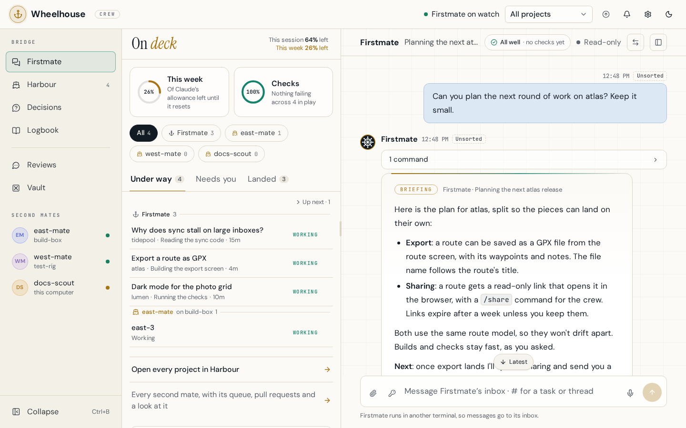
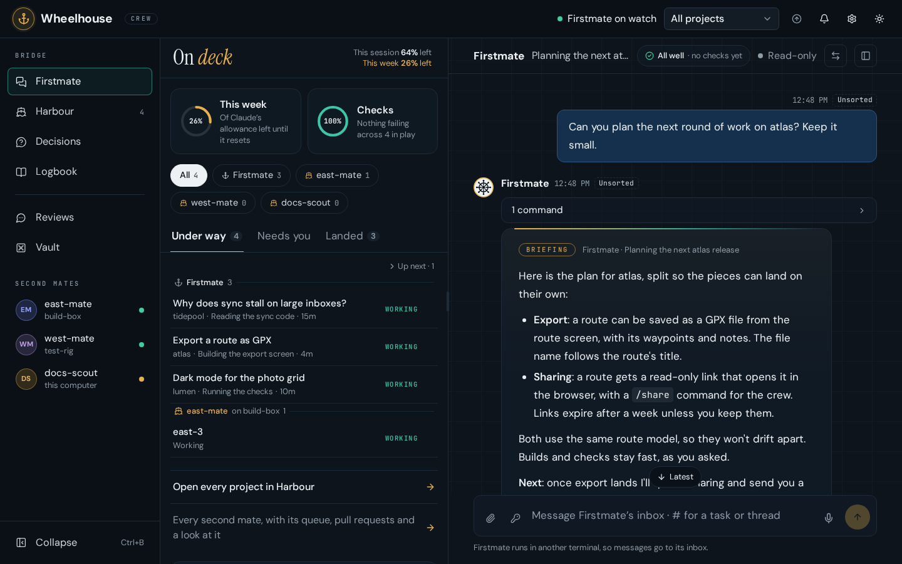

# Wheelhouse

**Run a crew of AI coding agents without living in their terminals.** ⚓

One calm page on your own machine to talk to [Firstmate](https://github.com/kunchenguid/firstmate), see what your crew is doing, and review real results.

## 🚀 Getting started

1. Clone Firstmate:

   ```bash
   git clone https://github.com/kunchenguid/firstmate.git
   ```

2. Install Wheelhouse:

   ```bash
   npm install -g @chrisjowen/wheelhouse
   ```

3. Open it from your Firstmate folder:

   ```bash
   cd firstmate
   wheelhouse open
   ```

Wheelhouse opens in your browser at the local URL it prints.

Running Wheelhouse from a clone instead (see [Developing Wheelhouse](docs/development.md))? The arrow-up icon in its header says when GitHub has a newer version and upgrades and restarts it on a click, as `wheelhouse upgrade` does in a terminal. Installed from npm, update with `npm install -g @chrisjowen/wheelhouse`.



<sub>Screenshots show a demo crew working on made-up projects.</sub>

## ✨ What you get

- 💬 **Talk to Firstmate like a teammate.** Chat, answer with buttons, mention tasks with `#`, run commands with `/`, or just dictate. A live preview shows as a card under the reply about it, and every open decision as a card you can answer in place.

  

  

- 🗺️ **Harbour.** Every project at a glance: what needs you, what is moving and what landed. Open one for its work, each task with a live console.

  

  

- 📡 **Radar.** Watch the whole fleet flow from Queued to Landed, live.

  

- 🔔 **The ship's bell.** Rings for green PRs, questions, stuck workers and landed merges.

  

- 📱 **From your phone.** Message Firstmate from Discord; its answers, alerts and decisions come back with buttons.

- ✅ **Decisions.** Only what Firstmate escalated to you, with its recommendation; what it settled itself waits, folded, under Handled by Firstmate.

  

- 🧭 **Task pages.** Every check, file, PR and log for a task in one place.

  

- 📜 **The conversation.** Every question a worker asked and how it was answered.

  

- 🛠️ **Passage editor.** Add your own steps, like a local deploy after merge.

  

- 🖥️ **Live preview.** Click around the real app and send feedback to the worker.

  

- 🤝 **Decided for you.** Every call Firstmate made on your behalf, with its reason.

  

- ⏱️ **Where time went & Headroom.** Spot the bottleneck and never run out of allowance.

  

  

- 📈 **Improvements.** Your harness gets better, only with your approval.

  

- 🌙 **Day or night.** A calm logbook look in light, deep navy after dark.

  

## 🔒 Yours, and only yours

- **Runs on your machine.** Wheelhouse serves only your own computer.
- **Firstmate stays in charge.** Close Wheelhouse and your crew keeps working.

## Details

### Requirements

Node.js 22 or newer, a Firstmate home, and `tmux` and Claude Code on your `PATH`. Run `wheelhouse open --help` for options, such as a different Firstmate home or port. Wheelhouse starts Firstmate, or finds the session already running.

### Privacy and safety

- Wheelhouse listens on `127.0.0.1` only and refuses requests from anywhere else.
- Reaching Wheelhouse from Docker, a cloud workspace or another computer? A plugin such as [Localhost proxy](https://github.com/chrisjowen/localhost-proxy-wheelhouse) can open the crew's localhost previews and links through Wheelhouse's own port; see [Host routes and address rewrites](docs/plugins.md#host-routes-and-address-rewrites).
- Everything you type goes to Firstmate; Wheelhouse never stops, reconfigures or bypasses it.
- Dictation (Ctrl/⌘+Shift+Space, hold for push-to-talk) uses the browser's built-in speech recognition. The microphone is on only while you dictate; in Chrome and Edge your voice goes to the browser maker's speech service (Google, in Chrome). Wheelhouse never records or stores audio, and says so before first use.
- The Discord gateway only connects out, hears only the account you pair, and keeps its bot token in the macOS Keychain (else a file only you can read). Nothing from it types into the Firstmate session or answers its prompts.
- Anything Firstmate doesn't record is labelled as unknown, never guessed.

### How the agents run

- **Decisions** shows only what Firstmate escalated to you, with its recommendation; everything it settled itself is folded under **Handled by Firstmate**, where you can take any of it over. **Chat about this** opens a question in the Firstmate chat with the form that fits it (one-tap answers, options to pick, or a written answer), which Firstmate can change as you talk it through; **Agree** sends its recommendation in one tap. Answers go to Firstmate as messages, and an answered card leaves at once. Keys: `j`/`k` move, `a` agree, `Enter` chat, `e` evidence, `l` later, `c` close.
- **Preview feedback** is talked through first: on a task's Live preview, a helper that sees only that preview (its page, screenshots, instructions and history) answers, asks and builds a feedback list you edit; **Send to Firstmate** sends the list as one message for the same task, and it shows in the chat.
- **Passage** checks that run a command stay off until you allow exactly those commands.
- **Shared reviews** (a bundled plugin, off until you turn it on) put a prototype or a worker's live app behind sign-in for several people to comment on the spot they mean; closing the review takes the link down and sends the comment threads the captain picks to Firstmate as one note for the task's worker. Reviews start as local previews, and go live only on a review server you deploy and name in its settings; see [Shared review](plugins/shared-review/README.md).
- **Improvements** needs improve's Wheelhouse plugin: `wheelhouse plugin install chrisjowen/improve`.
- **Secrets** reach the crew by name with `wh-vault`, installed alongside `wheelhouse`: values stay in the macOS login Keychain, and `wh-vault run -- <command>` gives one command its project's granted secrets. The **Vault** page shows names, grants and use, never a value, and is where you add secrets and choose which projects may use each; the key button under the Firstmate chat adds one too. Grants limit accidents and prompt injection, not a worker set on getting a secret.

### Learn more

- [Guide](docs/guide.md): every page in detail, the Firstmate session, [setting up the Discord gateway](docs/guide.md#the-messaging-gateway), options and security.
- [Passage files](docs/passages.md): add steps such as **Deployed**, **Released** or a local deploy.
- [The vault](docs/vault.md): `wh-vault`, secrets by name for the crew, and what it does not protect.
- [Plugins](docs/plugins.md): the built-in and bundled plugins, how to write one, and how to install and update one from its own repository (`wheelhouse plugin install org/repo`, or **Install plugin** on the Plugins page).
- [How Wheelhouse reads Firstmate](docs/architecture.md): its data sources, messaging and HTTP API.
- [Developing Wheelhouse](docs/development.md): running from a clone, tests and releases.
- [MVP spec](docs/spec.md).

## License

MIT
