# Wheelhouse

**Run a crew of AI coding agents without living in their terminals.** ⚓

One calm page on your own machine to talk to [Firstmate](https://github.com/kunchenguid/firstmate), see what your crew is doing, and review real results.

## 🚀 Getting started

1. Clone Firstmate:

   ```bash
   git clone https://github.com/kunchenguid/firstmate.git
   ```

2. Install Wheelhouse:

   ```bash
   npm install -g @chrisjowen/wheelhouse
   ```

3. Open it from your Firstmate folder:

   ```bash
   cd firstmate
   wheelhouse open
   ```

Wheelhouse opens in your browser at the local URL it prints.

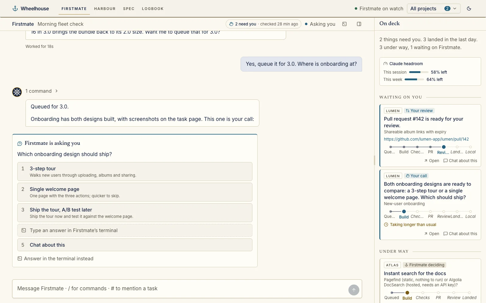

<sub>Screenshots show a demo crew working on made-up projects.</sub>

## ✨ What you get

- 💬 **Talk to Firstmate like a teammate.** Chat, answer with buttons, mention tasks with `#`, run commands with `/`, or just dictate.
- 🗺️ **Harbour.** What needs you first, then every task in flight with a live console.

  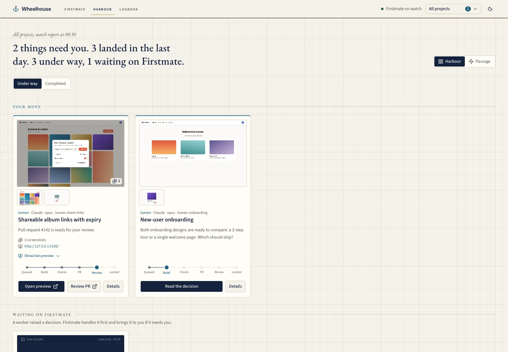

- 📡 **Radar.** Watch the whole fleet flow from Queued to Landed, live.

  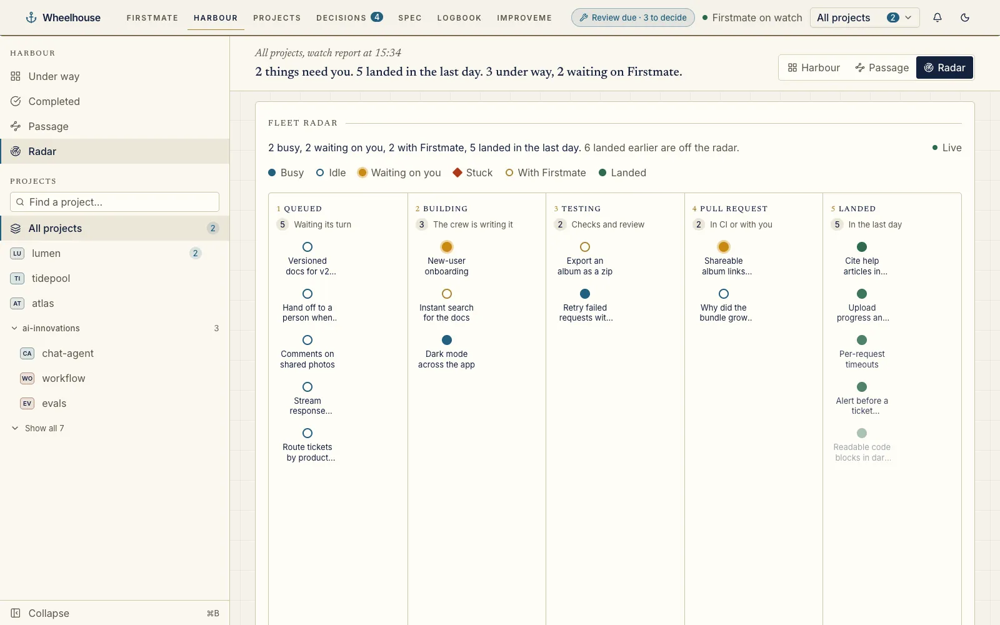

- 🔔 **The ship's bell.** Rings for green PRs, questions, stuck workers and landed merges.

  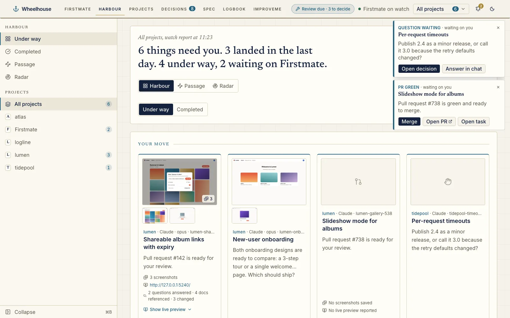

- ✅ **Decisions.** Every open question in one stack, answered in one tap.

  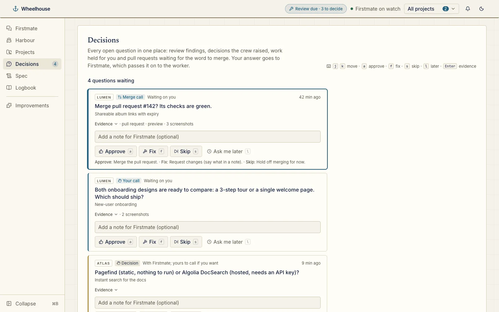

- 🧭 **Task pages.** Every check, file, PR and log for a task in one place.

  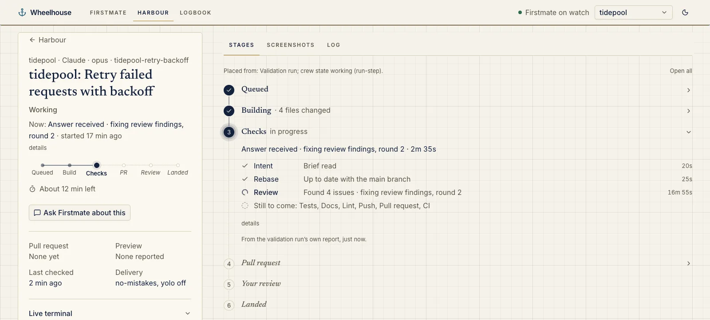

- 📜 **The conversation.** Every question a worker asked and how it was answered.

  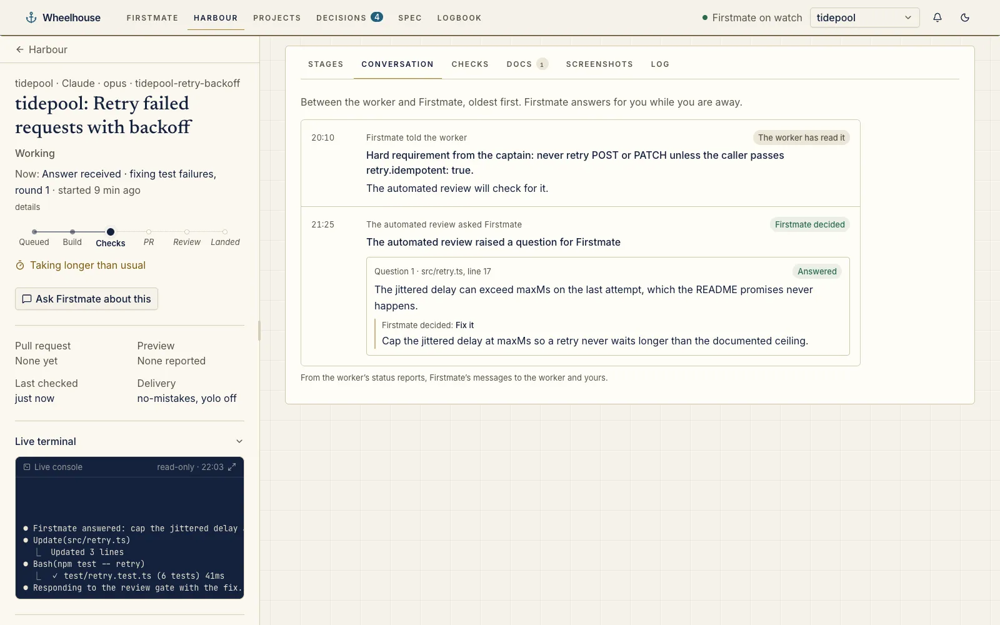

- 🛠️ **Passage editor.** Add your own steps, like a local deploy after merge.

  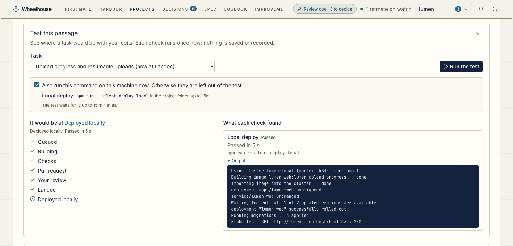

- 🔍 **Guided PR review.** The important changes first, with why each was made.

  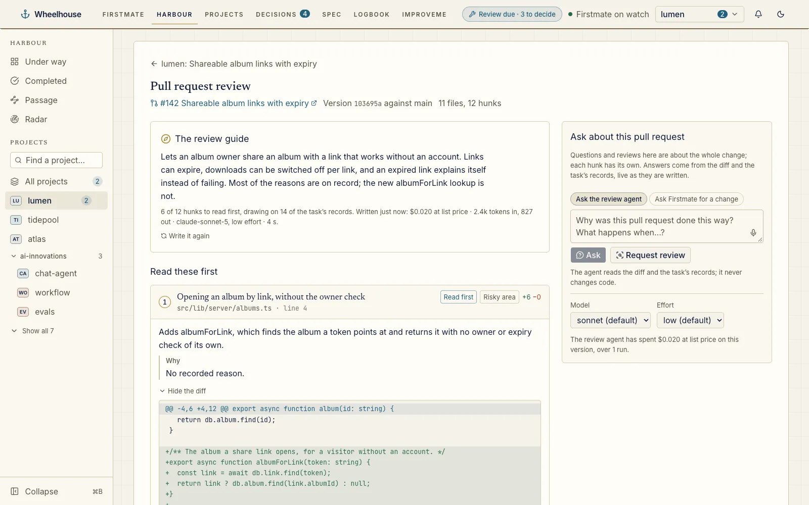

- 🖥️ **Live preview.** Click around the real app and send feedback to the worker.

  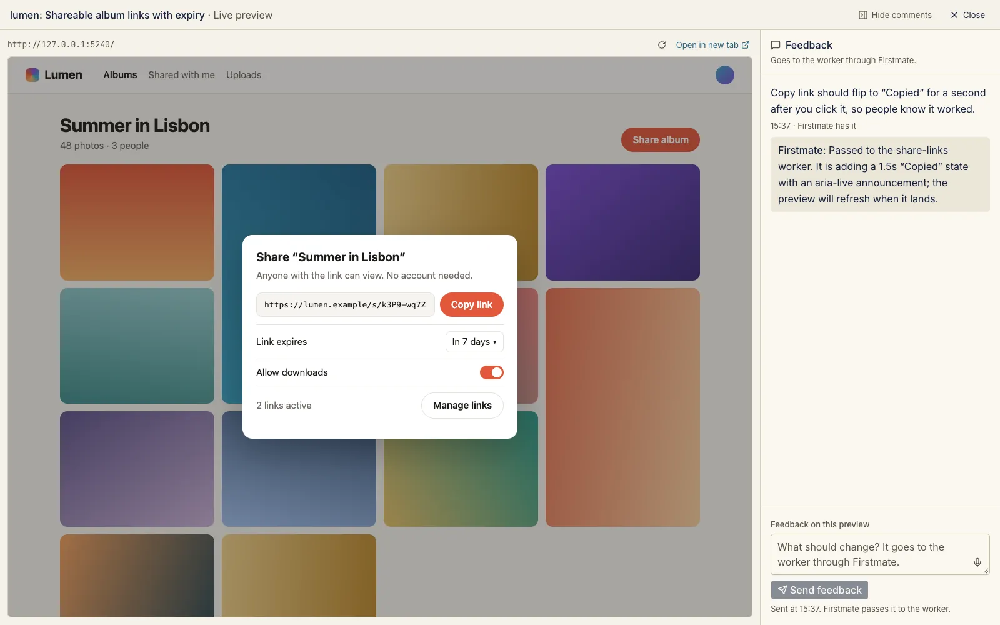

- 📝 **Spec interview.** Get grilled on what you want, watch the spec write itself, send it to build.

  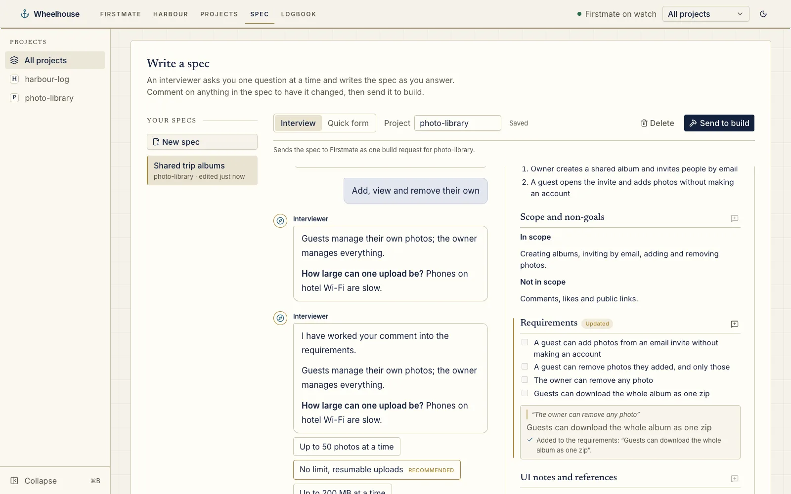

- 🤝 **Decided for you.** Every call Firstmate made on your behalf, with its reason.

  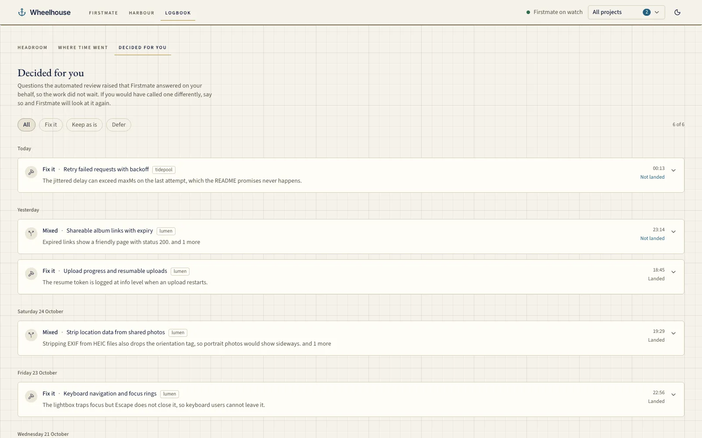

- ⏱️ **Where time went & Headroom.** Spot the bottleneck and never run out of allowance.

  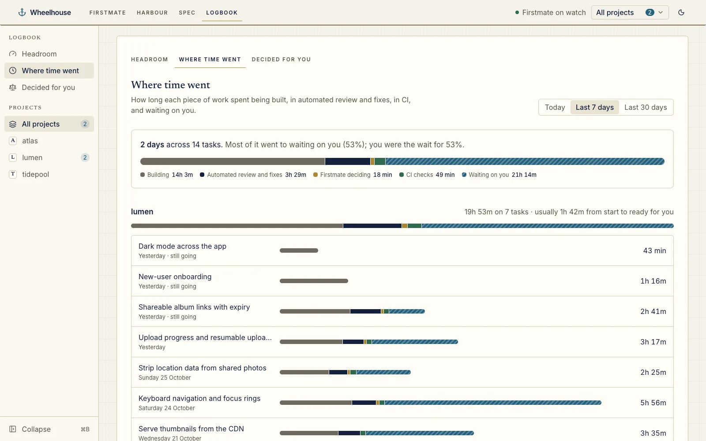

  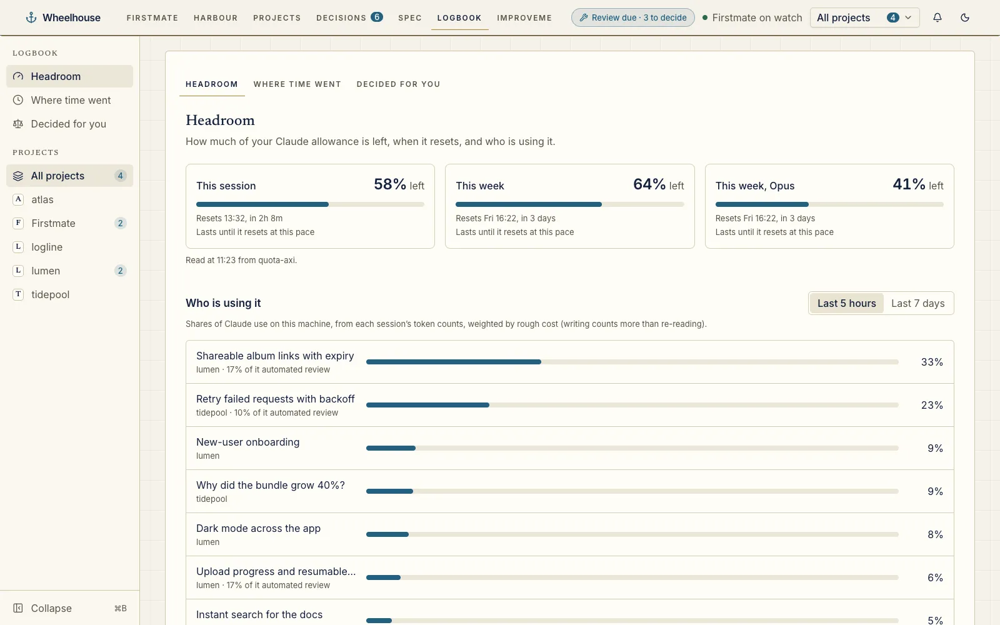

- 📈 **Improvements.** Your harness gets better, only with your approval.

  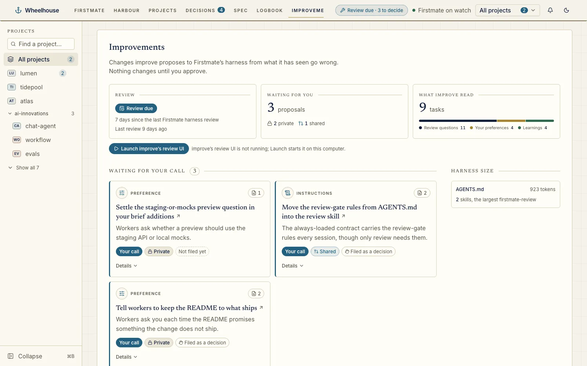

- 🌙 **Day or night.** A calm logbook look in light, deep navy after dark.

  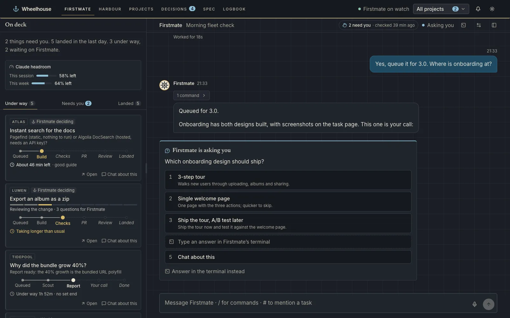

## 🔒 Yours, and only yours

- **Runs on your machine.** Wheelhouse serves only your own computer.
- **Firstmate stays in charge.** Close Wheelhouse and your crew keeps working.

## Details

### Requirements

Node.js 22 or newer, a Firstmate home, and `tmux` and Claude Code on your `PATH`. Run `wheelhouse open --help` for options, such as a different Firstmate home or port. Wheelhouse starts Firstmate, or finds the session already running.

### Privacy and safety

- Wheelhouse listens on `127.0.0.1` only and refuses requests from anywhere else.
- Everything you type goes to Firstmate; Wheelhouse never stops, reconfigures or bypasses it.
- Dictation (Ctrl/⌘+Shift+Space, hold for push-to-talk) uses the browser's built-in speech recognition. The microphone is on only while you dictate; in Chrome and Edge your voice goes to the browser maker's speech service (Google, in Chrome). Wheelhouse never records or stores audio, and says so before first use.
- Anything Firstmate doesn't record is labelled as unknown, never guessed.

### How the agents run

- **Decisions** answers go to Firstmate as messages; a card reads "sent to Firstmate" until the question closes. Keys: `j`/`k` move, `a`/`f`/`s` answer, `l` ask later, `c` close, Enter for evidence.
- **PR review** runs your own `claude` read-only with no tools, on request. Each run shows its cost, and a guide is cached per PR version.
- **Spec interview** runs your local `claude` CLI headless and read-only, with your `grilling` skill if you have one. It uses Sonnet at low effort unless you set `--spec-model` and `--spec-effort`. **Quick form** fills the same spec by hand.
- **Passage** checks that run a command stay off until you allow exactly those commands.
- **Improvements** needs improve's Wheelhouse plugin: `wheelhouse plugin install chrisjowen/improve`.

### Learn more

- [Guide](docs/guide.md): every page in detail, the Firstmate session, options and security.
- [Passage files](docs/passages.md): add steps such as **Deployed**, **Released** or a local deploy.
- [Plugins](docs/plugins.md): the built-in and bundled plugins, how to write one, and how to install one from its own repository (`wheelhouse plugin install org/repo`).
- [How Wheelhouse reads Firstmate](docs/architecture.md): its data sources, messaging and HTTP API.
- [Developing Wheelhouse](docs/development.md): running from a clone, tests and releases.
- [MVP spec](docs/spec.md).

## License

MIT
